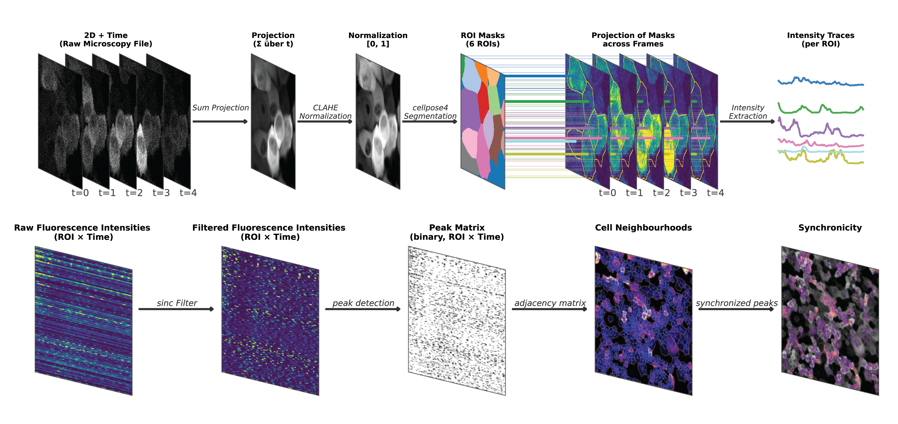

<p align="center">
  
</p>

<h1 align="center">pyKrait</h1>


<p align="center">
  <a href="https://pypi.org/project/pykrait/"></a>
  <a href="https://pypi.org/project/pykrait/"></a>
  <a href="https://github.com/&lt;your-org&gt;/pykrait/actions"></a>
    <a href="https://pykrait.readthedocs.io"></a>
  <a href="LICENSE"></a>
</p>
<p align="center">
  End-to-end pipeline for segmenting cells, detecting calcium peaks,<br>
  and quantifying oscillation periodicity and spatial synchronicity<br>
  from time-lapse microscopy.
</p>


<p align="center">
  
</p>

## Overview

pyKrait (**py**thon **C**alcium **r**ecording **a**nalysis and **i**nterpretation **t**oolbox) automatically processes calcium-imaging videos (.czi, .tif, .tiff) and computes calcium activity, peak statistics, periodicity scores, and neighbour-aware synchronicity z-scores.

## Installation

It is recommended to install pyKrait in a virtual environment using either venv or uv. The graphical user interface is optional, install it with `pip install "pykrait[gui]"`. 

### Standard `venv`

```bash
python -m venv .venv
source .venv/bin/activate           # Windows: .venv\Scripts\activate
pip install --upgrade pip
pip install pykrait
```

### Using `uv`

```bash
uv venv --python 3.11
source .venv/bin/activate           # Windows: .venv\Scripts\activate
uv pip install pykrait
```

## Quickstart

### Launch the GUI

From inside the activated virtual environment:
```bash
python -m pykrait
```

The GUI walks you through video selection, segmentation, peak detection, periodicity, and synchronicity, and lets you save results to disk.

### Batch process an entire folder

```python
from pykrait.pipeline.pipeline import BatchExperiment, AnalysisParameters
from pykrait.io.files import concat_analysis_files

experiment = BatchExperiment(
    folder="/path/to/videos",
    params=AnalysisParameters(),
    extension=".czi",
)
experiment.run()

concat_analysis_files("/path/to/videos", filetype="output")
```

This produces one `Analysis_<video>/` directory per video and an `analysis_output_overview.csv` at the root of the folder.

## Examples

| Scenario | Notebook |
|----------|----------|
| Run a folder with custom parameters | [`notebooks/example_batch_with_custom_parameters.ipynb`](notebooks/example_batch_with_custom_parameters.ipynb) |
| Re-run a folder reusing saved parameters and cached masks | [`notebooks/example_batch_reusing_parameters.ipynb`](notebooks/example_batch_reusing_parameters.ipynb) |
| Inspect or refine a single video interactively | Launch the GUI: `python -m pykrait` |

## How it works

For each video, pyKrait runs the following stages:

1. **Load** — lazy `Dask` array via `bioio` (`.czi`, `.tif`, `.tiff`).
2. **Project** — STD or SUM projection across time, with optional CLAHE.
3. **Segment** — Cellpose (`cpsam` by default, or a custom model path).
4. **Extract** — per-cell mean intensity per frame, computed lazily on Dask.
5. **Detrend** — Blackman-windowed sinc filter (cf. pyBOAT).
6. **Detect peaks** — `scipy.signal.find_peaks` with width / height / prominence thresholds.
7. **Periodicity** — STD and CoV of inter-peak intervals, scored against a shuffled-peaks null.
8. **Adjacency** — neighbour graph from segmented masks (kernel-based proximity).
9. **Synchronicity** — co-firing peaks within a time window and topological distance, z-scored against label-shuffled controls.

## Documentation

Full API reference and tutorials: **<https://pykrait.readthedocs.io/en/latest/>**.

## Acknowledgements

pyKrait builds on and heavily uses prior open-source work:

- [Cellpose](https://github.com/MouseLand/cellpose) for cell segmentation
- [pyBOAT](https://github.com/tensionhead/pyBOAT) for the sinc-filter detrending approach
- [bioio](https://github.com/bioio-devs/bioio) for image I/O
- [Dask](https://www.dask.org/) for lazy array computation

